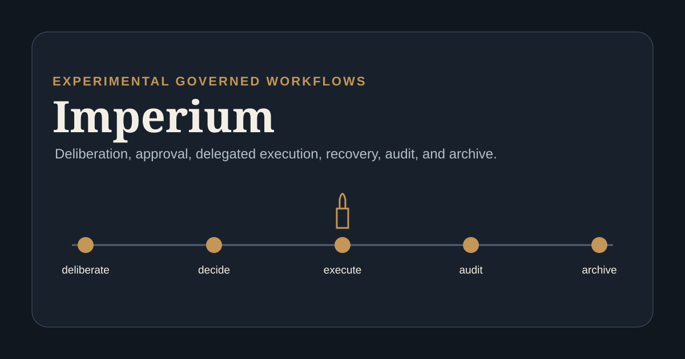
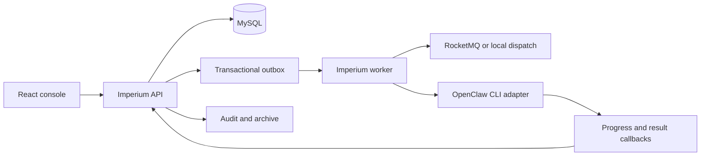

# Imperium

[](https://github.com/David-Lee-11101/Imperium/actions/workflows/ci.yml)

Imperium is an experimental workflow system for governed AI-assisted work. It models deliberation, veto review, human approval, delegated execution, recovery, audit, and archival as explicit state transitions instead of an unstructured agent conversation.

The repository contains an incomplete MVP and an architecture experiment. Unit-tested pieces are a foundation for further work; the full orchestration topology has not been validated.

**Proposed identity: Senate-Agent-Orchestration.** The repository remains named Imperium until a separate rename decision. See the [Roman Senate framework proposal](docs/SENATE_PROPOSAL.md) for planned roles, authority boundaries, and acceptance gates.

## What is implemented

- A Java 21 domain module with an explicit docket state machine and role-aware transitions.
- A Spring Boot API for dockets, senate opinions, decisions, delegations, execution tasks, audit records, and archives.
- A worker that routes outbox events, dispatches OpenClaw CLI tasks, and recovers stale executions.
- A React console for docket, audit, and archive workflows.
- MySQL migrations, Docker Compose topology, and local-versus-broker event dispatch modes.



The core lifecycle is similarly explicit:

```text
edict -> triage -> senate -> veto review -> human decision
      -> mandate -> delegation -> execution -> audit -> archive
```

See [Architecture](docs/ARCHITECTURE.md) for boundaries and failure behavior, and the [English product brief](docs/PRD.md) for the intended governance model. Contributions follow [CONTRIBUTING.md](CONTRIBUTING.md), while vulnerability reports follow [SECURITY.md](SECURITY.md).

## Repository structure

| Path | Responsibility |
| --- | --- |
| `backend/imperium-domain` | Domain entities, roles, operating modes, and state transitions |
| `backend/imperium-api` | Public API, internal callbacks, persistence, migrations, audit, and archive flows |
| `backend/imperium-worker` | Outbox publication, event routing, CLI dispatch, and recovery jobs |
| `frontend` | React and Vite operator console |
| `docs` | Product and technical design records |
| `scripts` | Local lifecycle, agent bootstrap, and repository validation tools |

## Verify the repository

Requirements: JDK 21, Maven 3.9+, Node.js 20+, and npm.

```bash
mvn --batch-mode --no-transfer-progress verify
cd frontend
npm ci
npm run build
cd ..
python3 scripts/validate_repository.py
```

These commands compile the backend, run the current unit tests, type-check and bundle the frontend, validate README links, and reject unsafe secret fallbacks. They do not start MySQL, RocketMQ, OpenClaw, or the complete application stack.

## Run the full local topology

Docker Compose is the intended integration environment:

```bash
cp .env.example .env
# Replace every placeholder password and secret in .env.
./scripts/dev-up.sh
```

The stack includes MySQL, RocketMQ, the API, worker, and web console. `OPENCLAW_BIN_PATH` and `OPENCLAW_STATE_DIR` must point to a local OpenClaw installation and state directory. This environment was not exercised during the current governance pass because Docker was unavailable.

## Configuration and trust boundaries

Database credentials, callback secrets, and internal-service secrets have no runtime defaults. The application fails during configuration when they are absent. Callback and internal orchestration endpoints use separate headers and should receive distinct random values.

Read [Security and configuration](docs/SECURITY.md) before connecting external services or exposing the API.

## Current limitations

- The implemented OpenClaw integration assumes a compatible local CLI and agent setup.
- End-to-end recovery behavior still depends on MySQL, RocketMQ, and external CLI processes.
- Local dispatch is a development path and does not demonstrate broker delivery guarantees.
- The frontend is an operator console for the MVP, not a finished product design.
- No performance, availability, or production deployment claims are made.

## Project status

Imperium is an experimental MVP under active development. Interfaces and workflow semantics may change as integration evidence grows.

## License

No open-source license has been selected. Original content remains subject to its copyright holders. No general reuse permission is granted for that content. GitHub platform viewing and forking rights still apply; third-party content retains its own notices and licenses.
